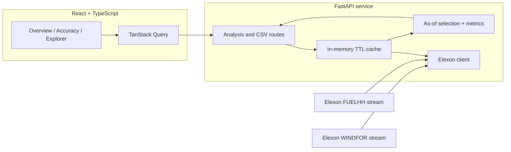

# Architecture

## Boundaries

- `elexon.py` owns upstream URLs, query windows, timeouts and response-shape validation.
- `analytics.py` is deterministic and has no HTTP or framework dependencies. It owns date interpretation, timestamp normalization, latest actual revision logic, forecast vintage selection and metric math.
- `demo_data.py` owns the deterministic synthetic fixture path; every fallback is tagged as demo at the API boundary.
- `main.py` owns HTTP routes, query validation, cache policy and CSV response formatting.
- `schemas.py` documents the response contracts used by frontend types.
- `frontend/src/lib/api.ts` owns the client and TypeScript contracts. Views handle presentation; charts are isolated components.

## Request path

1. The front end requests `/api/v1/analysis` with a cutoff and selected purchase-decision date.
2. FastAPI serves a short-lived in-memory cached raw-data bundle or fetches both Elexon streams concurrently.
3. The analysis function creates 744 expected hourly forecast records: each decision date in January maps to the next local delivery date. Each hourly actual is the average of the two corresponding half-hour FUELHH observations; incomplete pairs are left unmatched.
4. Every interval receives the latest forecast version published at or before that decision date's cutoff, then the latest available actual is aligned by delivery `startTime`.
5. Metrics are computed across matched pairs; missing pairs are preserved as records and reflected in coverage.
6. The API responds with metrics, daily aggregates, selected-day intervals, source status and a clear demo warning if applicable.

## Production hardening priorities

Persist versioned raw snapshots and a reproducible analysis manifest; validate upstream schema/query semantics with contract tests; add retry/backoff for transient failures; include a data freshness and last successful sync time; rate-limit public API access if exposed; add structured logs and request IDs; pin dependency lockfiles; and implement CI for Python tests and frontend build/typecheck. For a real market workflow, require an approved cutoff configuration and review process before a forecast is considered trading input.
